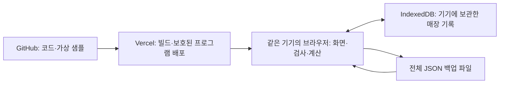

# 카페 운영 기록 프로그램 기술 요구사항 문서(TRD)

- 작성일·공식 자료 확인일: 2026-10-12
- 근거: `docs/01_PRD.md`, `docs/02_FRD.md`, `design/_1~_4/screen.png`·`code.html`, `design/brewmetrics_pastel_clean/DESIGN.md`.
- TRD는 선택한 기술, 자료 구조, 저장·계산·오류 대응과 배포 방법을 설명하는 문서다.
- 상태: 사용자 요청 ‘TRD문서는 추천대로 하고 완료해줘’에 따라 추천 구현 방향을 채택하고 1차 TRD를 최종 정리했다. 실제 코드 작성·검사·GitHub 연결·Vercel 배포는 아직 수행하지 않았다.
- 우선순위: PRD의 기능 범위·운영 의미 → FRD의 사용 순서·계산·예외 기준 → 시안의 표현. 시안의 추가 기능이나 고정 예시값을 실제 동작으로 구현하지 않는다.

## 1. 구현 방향

**React·TypeScript·Vite로 만든 웹 프로그램을 Vercel에 배포하고, 매장 기록과 계산은 사용자의 브라우저 안에서 처리한다. 코드는 GitHub 비공개 저장소에 보관한다.** 서버에 매장 기록을 저장하는 별도 데이터베이스는 두지 않는다.

사용 범위는 한 매장·한 사람·한 기기다. 최신 안정 버전의 Windows Chrome 또는 Edge 한 브라우저의 한 프로필과 고정 접속 주소를 실제 이용 환경으로 정한다. 프로그램 설치형 앱, 여러 기기 동기화, 직원별 계정·권한, POS·AI·발주 연동은 추가하지 않는다.

사용자가 새로 지정한 GitHub·Vercel은 코드의 보관·배포 장소다. PRD의 ‘기기에 기록 보관’ 의미는 유지한다. 매장 기록을 Vercel이나 GitHub로 올리지 않는다. 인터넷 공개 서비스 대신 Vercel의 접근 보호로 소유자만 접속 가능한 운영 페이지를 구성한다. 앱 자체의 로그인 기능을 추가하는 것이 아니라 배포 접근 설정이다.

Vercel에서 프로그램 파일을 처음 받거나 업데이트할 때는 인터넷이 필요하다. 이미 열린 프로그램의 기록·계산은 브라우저에서 처리한다. 오프라인 재접속·오프라인 설치를 보장하는 별도 기능은 1차에 없다.

위 화살표에는 실제 매장 기록이 GitHub·Vercel로 올라가는 경로가 없다. 단, 서비스 접속·Vercel 인증 과정에서는 IP·접속 주소·인증 정보 등 서비스 운영 정보가 외부에서 처리된다. 이를 ‘모든 정보가 외부로 나가지 않는다’고 표현하지 않는다.

## 2. 선택 기술과 이유

| 영역 | 선택 | 쉬운 설명과 선택 이유 |
|---|---|---|
| 화면 | React 19 계열의 최신 보안 수정 안정 버전 | 입력 변화에 맞춰 표와 합계를 함께 갱신하는 화면 도구 |
| 개발 언어 | TypeScript | 날짜·금액·번호 등의 자료 종류를 개발 중에 확인해 실수를 줄임 |
| 개발·배포용 변환 | Vite의 안정 버전 | 개발 파일을 브라우저가 읽는 파일로 묶는 도구. 서버 계산이 필요 없는 이번 규모에 적합 |
| 빌드 실행 환경 | Node.js 24 LTS | 개발·빌드에만 사용. 운영 매장 기록을 처리하는 서버로 쓰지 않음 |
| 화면 스타일 | CSS 변수와 CSS Modules | 시안의 색·여백·글꼴·표 표현을 옮기고 각 화면 스타일 충돌을 줄임 |
| 자료 보관 | IndexedDB + `idb` | 브라우저의 큰 자료 보관함과 이를 다루기 쉽게 하는 작은 도구 |
| 입력·백업 검사 | Zod 안정 버전 | 자료가 정한 구조와 범위에 맞는지 동일한 규칙으로 검사 |
| 금액 계산 | `decimal.js` | 소수 원가의 계산 오차를 줄이는 십진수 계산 도구 |
| 상태 관리 | React 기본 상태·Context·Reducer | 화면 입력과 저장된 자료를 구분. 별도 큰 상태 관리 도구는 추가하지 않음 |
| 화면 이동 | 한 HTML 페이지 안의 해시 주소 | `/#sales`처럼 화면을 구분. 새로고침에서 별도 서버 경로 설정을 줄임 |
| 검사 | Vitest·React Testing Library·Playwright | 계산, 입력·저장, 실제 브라우저의 전체 흐름을 각각 검사 |
| 코드·배포 | GitHub 비공개 저장소 + Vercel Git 연동 | 코드 변경 이력 보관, 미리보기 검사 후 정식 배포 |

Vite는 공식적으로 React·TypeScript 구성과 Node 실행 조건을 안내하고 있으며, Vercel에는 Vite 배포 안내가 있다. Node 24 LTS는 Vercel 빌드 환경에서 지원한다. [Vite 시작 안내](https://vite.dev/guide/), [Vercel의 Vite 안내](https://vercel.com/docs/frameworks/frontend/vite), [Vercel Node 24 지원 안내](https://vercel.com/changelog/node-js-24-lts-is-now-generally-available-for-builds-and-functions).

React 계열은 공식 버전 안내의 안정 계열을 기준으로 선택한다. 정확한 패키지 수정 버전은 구현 시작 때 서로 호환되는 안정 버전을 확인해 `package.json`과 `package-lock.json`으로 고정한다. Vercel과 개발 환경은 같은 Node 주 버전을 사용하고 `npm ci`로 동일한 의존성을 설치한다. 실행 중 CDN에서 프레임워크를 내려받는 시안 코드는 사용하지 않는다. [React 공식 버전 안내](https://react.dev/versions).

Next.js·서버 함수·서버 데이터베이스·차트 전문 라이브러리는 1차 필수 기능에 필요하지 않아 선택하지 않는다. FRD에 없는 분석 차트를 기술 선택 때문에 새로 만들지 않는다.

## 3. 화면과 내부 구성

### 3.1 화면 구성과 사용 순서

| 화면 | 구현 대상 | FRD 대응 |
|---|---|---|
| 판매 기록·메뉴 수익성 | 입력, 미리보기, 집계 목록, 판매 수정·삭제, 메뉴 결과 | F03~F06 |
| 실적·운영 손익 | 기간과 기록 상태, 항목별 실제 금액, 손익·미완성 안내 | F02·F09 |
| 재료 잔량·기록 | 입고·폐기·마감 실측 입력, 종료일 마감 잔량, 실측·추정 구분 | F10~F13 |
| 운영비 | 귀속일별 입력·목록·수정·삭제, 항목 합계 | F07·F08 |
| 자료 관리 영역 | 저장 상태, 전체 백업·복원 | F14~F16 |

화면에서 메뉴 실적을 보던 기간이 손익 조회에도 적용된다. 저장 후 사용자가 메뉴 수익성 → 운영 손익 → 재료 잔량을 이어서 확인할 수 있다. 화면 이동만으로 자료를 수정하거나 파일을 만들지 않는다.

시안의 부가세 포함·POS 상태·발주·예상치·지점 선택·신규 재료 등록·고정/변동 분류·증빙·반복 비용·손익 마감 잠금 등은 FRD 2절의 제외 기준대로 처리한다. 판매 수정·삭제, 폐기와 백업·복원은 FRD대로 보완한다.

글꼴은 시안의 Plus Jakarta Sans·Manrope를 필요한 범위만 로컬 자원으로 포함하고 한국어 글꼴 대체를 지정한다. 배포 시 글꼴의 배포 허용 조건을 확인한다. 아이콘도 배포 파일에 포함한다. 운영 중 Google Fonts·Tailwind CDN 호출은 제거한다. 디자인 문서의 색·숫자 정렬·상태 표현을 이용하되 상태 색상에 새로운 등급 계산을 붙이지 않는다.

### 3.2 코드 책임 구분

아래 경로는 구현할 구조이며 현재 생성된 코드 파일을 뜻하지 않는다.

| 구조 | 책임 |
|---|---|
| `src/features/sales`, `costs`, `inventory`, `reports`, `backup` | 각 화면·입력·사용자 동작 |
| `src/domain/types`·`validation` | 자료의 종류·입력 범위·백업 구조 검사 |
| `src/domain/calculations` | FRD C01~C04 계산만 담당. 화면이나 저장 기술과 분리 |
| `src/domain/commands` | 추가·수정·삭제·실측 반영의 연결 처리 |
| `src/data/repository` | IndexedDB 읽기·쓰기·복원·버전 검사 |
| `src/state` | 보관 자료의 현재 판본, 조회 기간, 저장 상태 |
| `src/components`·`src/styles` | 공통 입력·표·메시지·시안 스타일 |
| `src/data/seed` | 검증한 가상 샘플만 포함 |
| `tests` | 계산·저장·전체 흐름 검사 |

화면마다 다른 계산을 복사하지 않는다. 판매 미리보기·메뉴 집계·운영 손익·백업 평가값이 모두 같은 계산 모듈을 사용한다. 함수는 자료를 받아 결과를 돌려주며 원본을 몰래 바꾸지 않는다.

## 4. 자료 구조

### 4.1 공통 표현

- 업무 날짜: `YYYY-MM-DD` 문자열. 한국 매장의 하루 기준이며 날짜 계산에서 UTC 변환으로 하루가 바뀌지 않게 한다. 생성·수정·백업 시각은 시간대가 포함된 별도 시각으로 보관한다.
- 번호: 원본 `sale_id`·`expense_id`·`event_id` 등 유지. 새 기록은 `crypto.randomUUID()`로 충돌 없는 별도 번호를 생성한다.
- 금액·소수 수량: 내부 저장·백업에서는 검증된 십진수 문자열로 표현한다. 제공 JSON의 숫자는 초기 변환 때 십진수 문자열로 정규화한다. 0은 `"0"`, 미입력은 `null` 등 명시적인 상태로 구분한다.
- 단위: `g`·`ml`·`개`. 개는 정수, g·ml는 소수 입력을 허용한다. kg·팩·병을 임의로 같은 값으로 취급하지 않는다.
- 당시 원가: 재료원가·포장원가·레시피 버전·가격 근거·계산 기준 버전·완성 여부를 함께 보관한다.
- 자료 판본 `revision`: 보관 자료가 변경될 때 증가하는 번호. 화면을 열 때와 저장할 때 자료가 달라졌는지 확인하는 용도다.
- 자료 집합 `generationId`: 전체 복원 전·후 자료를 구분하는 묶음 번호. 화면 기능으로 자료 이력을 제공하는 것은 아니다.

### 4.2 IndexedDB 보관 영역

데이터베이스 이름은 `prep-cafe-operations`로 고정하고 구조 버전은 정수로 관리한다. 각 기록 키는 자료 집합 번호와 원본 식별자를 결합한다.

| 보관 영역 | 주요 자료 | 조회용 표시·찾기 기준 |
|---|---|---|
| `appMeta` | 현재 자료 집합, 구조·계산 버전, 판본, 초기 준비 완료 여부 | 하나의 현재 상태 |
| `suppliers`·`materials`·`menus` | 기존 공급사·재료·메뉴 | 대상 번호 |
| `recipes` | 버전·메뉴·재료·사용량·단위·채널 | 메뉴·버전 |
| `priceHistory` | 재료·시작일·구매가격·구매용량 | 재료·시작일 |
| `calendar` | 날짜·영업·마감·수정 후 확인 필요 상태 | 날짜 |
| `sales` | 판매 입력, 당시 확정값·원가 근거 | 날짜, 메뉴, 날짜·메뉴·채널 고유 조합 |
| `expenses` | 귀속일·비용항목·금액·원본 배분 기준 | 날짜·비용항목 |
| `openingInventory` | 기준일·재료·초기수량·단위 | 재료 |
| `inventoryEvents` | 입고·폐기·실측, 증감·실측량·사유·단가 | 날짜·재료, 실측일·재료 고유 조합 |
| `monthlyExpensePlan` | 원본 월 비용 계획 | 월·항목. 읽기용 자료이며 비용 중복 집계 금지 |
| `datasetInfo`·`settings` | 출처·기간·통화·운영 설정 | 전체 백업 포함 |
| `operationReceipts` | 저장 요청 번호와 완료 여부 | 중복 클릭·응답 유실 재시도 방지 |

레시피의 선택적인 `channel_only`와 실측의 `counted_quantity`는 누락과 0을 구분해 보존한다. 원본 필드 이름과 내부 이름을 연결하는 변환표를 관리한다. 입고 증감은 양수, 폐기는 음수, 실측 차이는 양수·음수·0으로 구분한다. 사용자 폐기 입력의 양수를 보관용 음수로 바꾸는 변환은 한 번만 수행한다. 백업은 TRD의 정규 자료 구조를 사용하고 원본 JSON과 구분되는 형식 식별자를 둔다.

고유 색인에는 `generationId`를 포함해 복원 준비 자료와 현재 자료의 번호가 충돌하지 않게 한다. 마감 실측의 고유 조합은 실측 이벤트에만 `auditKey`를 부여하는 방식으로 검사한다. 입고·폐기에는 이 키를 두지 않아 같은 날 같은 재료의 여러 입고·폐기를 잘못 거절하지 않는다.

### 4.3 자료 연결 원칙

판매는 메뉴와 레시피 버전, 레시피는 재료, 재료는 공급사를 참조한다. 입고·폐기·실측은 재료를 참조한다. 존재하지 않는 번호는 입력·초기 준비·복원 검사에서 거절한다.

기간 합계·메뉴 이익률·현재 잔량은 원본 기록에서 다시 만들 수 있는 결과다. 결과를 별도 영구 자료로 중복 보관하지 않고 메모리에 계산해 둔다. 당시 원가와 폐기 평가 근거는 과거 의미 보존이 필요하므로 원본 기록의 일부로 영구 보관한다.

## 5. 초기 자료·가져오기·저장

### 5.1 초기 자료

1. 구현 준비 단계에서 제공 JSON을 검사해 정규화된 가상 샘플을 만든다. 엑셀·JSON을 합치지 않는다.
2. 프로그램 시작 시 DB 현재 자료 상태를 먼저 읽는다.
3. DB가 정상적으로 비어 있고 초기 준비 완료 기록이 없을 때만 샘플을 한 번 준비한다.
4. 모든 기록과 초기 준비 상태를 한 트랜잭션으로 보관한다. 트랜잭션은 여러 보관 작업을 모두 성공시키거나 모두 취소하는 처리 단위다.
5. 기존 자료가 깨졌거나 열리지 않는 경우에는 샘플을 새로 넣지 않는다. 복원·재시도 안내를 제공한다.

원본 샘플은 가상 자료라는 표기를 보존한다. 실제 매장 자료를 `public` 폴더나 번들에 넣어 배포하는 구조로 바꾸지 않는다. 처음 준비하는 샘플 파일은 필요할 때만 읽어 화면 초기 파일 크기를 줄인다.

### 5.2 ‘가져오기’의 1차 범위

1차에는 **준비된 초기 샘플 이용과 앱의 전체 백업 JSON 복원만** 있다. 사용자가 작성한 엑셀·CSV·임의 JSON을 가져오는 기능은 구현하지 않는다. 백업 파일 형식이 일치하지 않는 원본 JSON을 복원으로 우회 입력하지 않는다. 2차 엑셀 추가 시에도 이번 단계의 기록·계산 기준을 바꾸려면 FRD부터 개정해야 한다.

### 5.3 추가·수정·삭제의 공통 처리

입력 검사 → 계산 미리보기 → 저장 요청 → 판본·대상·중복 검사 → 관련 기록과 상태 함께 보관 → 트랜잭션 성공 확인 → 자료 다시 읽기·계산 → 화면 성공 표시 순서다. 복원·초기 준비와 동시에 일상 저장을 진행하지 않는다.

`idb`의 완료 Promise인 `tx.done`까지 확인한다. 트랜잭션 안에서는 네트워크 요청·파일 다운로드·별도 기다림을 수행하지 않는다. 그런 작업은 거래 시작 전에 끝내거나 거래 완료 뒤 수행한다. 이는 브라우저가 작업 중 거래를 닫아 버리는 문제를 피하기 위한 것이다. [idb 공식 안내](https://github.com/jakearchibald/idb), [IndexedDB 사용 안내](https://developer.mozilla.org/en-US/docs/Web/API/IndexedDB_API/Using_IndexedDB).

중복 저장 요청은 같은 요청번호를 재사용하고 완료 영수증으로 한 번만 반영한다. 판매의 날짜·메뉴·채널 고유성도 DB에서 확인한다. 운영비는 같은 날짜·항목의 여러 기록을 허용하므로 판매처럼 고유성을 강제하지 않는다.

같은 PC에서 실수로 여러 탭을 열면 읽기는 가능하지만 쓰기 직전 `revision` 비교를 한다. 오래된 화면이면 덮어쓰지 않고 새로 읽으라고 안내한다. `BroadcastChannel`로 자료 변경을 알려 오래된 화면의 저장·복원을 막는다. 여러 직원 동시 사용 기능을 제공하는 뜻이 아니다.

## 6. 계산 구현 계약

계산의 기준은 **FRD C01~C04**다. TRD에서는 산식·사용 순서·원가 의미를 변경하지 않는다.

| 계산 모듈 | 반드시 유지할 기준 |
|---|---|
| 판매 계산 | 수량×당시 단가−기록 전체 할인. 수수료는 실제 기록 전체 금액 |
| 새 원가 | 기록일 이전/당일 최신 가격, 구매가격÷구매용량, 채널별 레시피 |
| 당시 값 보존 | 기존 순매출·수수료·개당 원가 사용. 불일치는 표시하고 자동 덮어쓰기 금지 |
| 메뉴 집계 | 재료·포장·수수료 고려. 비율은 합계끼리 계산, 현재 기준가로 과거 평균 대체 금지 |
| 운영비·손익 | 귀속일 합계, 월 계획 중복 금지, 폐기 평가 포함, 구매대금 전체·미확인 실사 차이 금액 제외 |
| 재고 재생 | 초기/직전 실측에서 입고·판매 사용·폐기 반영, 같은 날 마감 실측은 마지막 |
| 과거 수정 | 영향 기간·재료 결과 재계산, 이후 실제로 센 절대수량 보존 |

`decimal.js`를 공통 계산 도구로 사용하며 정밀도는 최소 28 유효자리, 표시 반올림은 `ROUND_HALF_UP`으로 고정한다. 계산 중 원 단위 반올림하지 않는다. 저장된 십진수 문자열을 직접 계산에 넣고 `Number` 변환·이진수 연산으로 원가를 누적하지 않는다. 지원 입력 크기 내에서 정밀도가 충분한지 검사하고 무한대·NaN·범위 초과는 저장 오류로 처리한다. [decimal.js 공식 API](https://mikemcl.github.io/decimal.js/).

월 비용 배분은 FRD의 달력 날짜 기준·앞 날짜부터 잔여 원 배분을 유지한다. 1차에 월 비용 자동 생성 UI는 만들지 않는다. g·ml 수량은 계산값을 보존해 표시하고 개 수량은 정수 검사를 한다. 화면 표시와 백업 값의 차이는 표시 반올림 때문임을 구분한다.

재고 계산은 재료별 날짜순으로 묶고 같은 날 입고·판매·폐기를 반영한 뒤 실측 기준으로 마감한다. 시간 정보가 없는 원본에 임의의 시각이나 실제 시간순서를 만들지 않는다. 실측의 원본 증감과 재생한 차이가 달라도 실측수량 자체는 바꾸지 않는다.

계산 결과 타입에는 값 외에 `complete / incomplete / unavailable`, 누락 근거 목록을 둔다. 부분합은 부분합으로 표시하고 미입력 원가를 0으로 바꾸지 않는다. 미래·미마감·기록 없음·확인된 0을 구분한다. 0으로 나누는 이익률은 값 없이 계산 불가 상태를 반환한다.

## 7. 전체 백업과 복원

### 7.1 백업 파일 형식

UTF-8 JSON 한 파일로 전체 자료를 내려받는다. 최상위 구조는 다음과 같다. 이는 구조 설계이며 구현 코드가 아니다.

| 항목 | 내용 |
|---|---|
| `format` | `prep-cafe-backup` 고정 식별자 |
| `formatVersion`·`schemaVersion` | 백업·저장 자료 구조 버전 |
| `calculationVersion` | 적용 FRD 계산 기준 버전 |
| `createdAt`·`displayTimeZone` | 생성 시각과 `Asia/Seoul` 표시 기준 |
| `store`·`datasetMeta` | 매장·샘플 출처·기간·통화·세금 기준 |
| `counts` | 기록 종류별 건수 |
| `data` | 전체 기록·기준자료·당시 원가·폐기 평가 근거 |
| `settings` | 운영 설정 |

화면의 필터·검색·페이지와 아직 저장하지 않은 입력은 백업 기록으로 포함하지 않는다. DB 판본과 현재 자료 집합을 고정해 읽고, 읽는 도중 다른 자료로 바뀌면 백업을 다시 시작한다. 파일 생성에는 브라우저 Blob과 다운로드 링크를 사용한다. 내려받기 준비가 끝났다는 사실과 실제 파일이 사용자 폴더에 있는지는 구분한다.

JSON은 암호화된 파일이 아니다. 1차에 비밀번호 백업을 새 기능으로 추가하지 않는다. 실제 비용·판매 기록이 포함될 수 있으므로 개인 폴더에 보관하고 공개 저장소·공유 링크에 올리지 않도록 설명한다.

### 7.2 복원 절차와 실패 안전성

FRD F16 순서를 유지한다.

1. 사용자 파일을 브라우저 안에서 읽고 파싱한다. 서버로 업로드하지 않는다.
2. 파일 식별자·버전·통화·세금·번호·참조·단위·수치·건수·전체 구조를 검사한다. `.json` 확장자만 믿지 않는다. 정상적인 원가 미완성 상태는 허용한다.
3. 매장·생성 시각·기록 수·계산 기준과 전체 대체 의미를 보여준다. 지원하지 않는 계산 기준 버전이면 다른 산식으로 몰래 바꾸지 않고 복원을 거절한다.
4. 현재 전체 백업 파일을 먼저 준비하고 파일 보관 확인을 안내한다. 사용자가 취소하거나 준비 실패 시 다음 단계로 진행하지 않는다.
5. 검증된 새 자료를 별도 `generationId`로 보관한다. 현재 화면은 아직 이전 자료를 이용한다.
6. 새 자료의 종류별 수와 참조·계산 상태를 확인한다.
7. `appMeta`의 현재 자료 집합·판본·설정을 하나의 짧은 거래로 새 집합으로 전환한다. 전환이 성공한 뒤만 화면을 새로 읽는다.
8. 이전 집합은 안전 확인 후 정리한다. 임시 집합 정리는 사용자 복원 이력 기능으로 노출하지 않는다.

중간에 창이 닫히거나 쓰기가 실패해도 현재 자료 집합 포인터가 이전 자료 또는 검증 완료된 새 자료를 가리키게 한다. 일부 기록만 새 자료가 된 상태는 이용하지 않는다. 저장공간이 두 집합을 잠시 보관할 만큼 없으면 복원 전에 안내하고 이전 자료를 먼저 지워 공간을 만드는 우회는 하지 않는다.

백업 검사만으로 금액이 현실의 거래와 일치하는지 보증할 수는 없다. 파일의 내용은 텍스트로 표시해 악성 HTML이 실행되지 않도록 한다. 현재 자료와 백업을 합치거나 원본 샘플로 자동 보충하지 않는다.

### 7.3 업데이트와 자료 호환성

DB 구조 변경과 계산 기준 변경을 구분한다. 1차 계산 기준은 고정하며 기능 업데이트가 과거 가격·원가를 바꾸지 않는다. 자료 구조 변환이 필요하면 변환 전 전체 백업, 호환 검사, 건수·금액·당시 값 비교를 수행한다. 지원하지 않는 새 버전의 백업이나 DB는 열람·쓰기 오류를 안내하고 삭제하지 않는다.

코드를 이전 배포로 되돌려도 브라우저 자료가 이전 시점으로 돌아가는 것은 아니다. 코드 되돌리기 전에 그 코드가 현재 DB 버전을 읽을 수 있는지 확인한다. 안 되면 DB를 삭제하지 말고 호환 코드 재배포 또는 사용자 백업 복원을 선택한다.

## 8. 개인정보·접근 보호

- 필요한 자료는 메뉴·재료·집계 판매·운영비다. 고객 이름·연락처·카드번호·직원 개인 급여명세·영수증 파일을 수집하지 않는다. PRD의 기능을 확대하는 입력칸도 만들지 않는다.
- 실제 기록·백업·오류 입력값을 GitHub, 배포 파일, 환경변수, 분석 도구, 서버 로그에 넣지 않는다. 오류는 안전한 오류 코드와 단계만 표시한다. 외부 오류 수집·방문 분석 도구는 기본 비활성화한다.
- GitHub는 비공개로 설정하고 계정 2단계 인증을 사용한다. 코드·문서·검사용 가상 자료와 의존성 잠금파일만 보관한다. 실제 자료·백업·`.env`·접근 토큰은 `.gitignore`로 제외하며 공개 가능 폴더와 빌드 결과를 검사한다.
- Vercel Authentication의 **All Deployments**로 운영·미리보기 주소를 모두 보호한다. 공유 우회 링크나 예외 공개 설정을 만들지 않는다. 앱 사용자는 Vercel 프로젝트 접근 권한을 가진 본인이다.
- 공식 2026-09-09 변경 발표에 따르면 모든 요금제에서 운영 배포까지 Vercel 인증으로 보호할 수 있다. 이전 문서의 ‘운영 도메인은 유료 추가 보호 필요’와 차이가 있으므로 더 최근 공식 발표와 실제 프로젝트 설정을 기준으로 확인한다. 적용 옵션이 실제 계정에 보이지 않으면 공개 배포로 우회하지 않고 배포 설정 문제를 해결한다. [Vercel 공식 접근 보호 변경 발표](https://vercel.com/changelog/protect-production-deployments-for-free-on-every-plan).
- HTTPS를 사용한다. 앱 보안 헤더에는 `X-Content-Type-Options: nosniff`, 보수적인 Referrer-Policy와 CSP를 적용한다. CSP는 같은 출처의 배포 파일을 기본 허용하고 임의 외부 스크립트·인라인 실행·프레임 삽입을 제한한다. Vercel 인증·빌드 자원에 필요한 예외는 실제 배포에서 검증해 최소만 허용한다.
- 사용자 입력·복원 파일을 HTML로 직접 출력하거나 `eval`로 실행하지 않는다. 표의 이름·사유는 텍스트로 렌더링한다. UI 검사를 우회한 기록도 보관 직전에 다시 검사한다.
- 브라우저 DB와 백업을 앱 수준에서 암호화하는 기능은 1차에 없다. 기기 잠금·OS 사용자 계정·개인 브라우저 프로필과 백업 파일 관리가 필요하다. Vercel 인증은 로컬 파일이나 PC에 접근하는 사람까지 막는 기능이 아니다.

## 9. 저장 신뢰성과 브라우저 제한

IndexedDB는 주소의 출처(프로토콜·도메인·포트)와 브라우저 프로필별로 구분된다. 같은 PC에서도 다른 브라우저·미리보기 URL·도메인에서는 별도 자료다. 운영 주소 하나를 고정하고 미리보기에는 실제 자료를 입력하지 않는다. 주소를 바꿔야 하면 기존 주소에서 백업한 뒤 새 주소에서 복원한다. [MDN 저장공간·삭제 기준](https://developer.mozilla.org/en-US/docs/Web/API/Storage_API/Storage_quotas_and_eviction_criteria).

`navigator.storage.persist()`로 영구 보관 승인을 요청하고 `estimate()`로 이용량을 참고한다. 승인되지 않아도 저장은 가능할 수 있으나 영구 보관을 보장한다고 표시하지 않는다. 브라우저 설정 삭제·비공개 창 종료·PC 손상·운영체제 문제에는 로컬 기록이 사라질 수 있다. 백업은 브라우저 밖 파일로 보관해야 한다. 저장 권한·할당량 오류는 F14의 실패 처리로 연결한다. [MDN Storage API](https://developer.mozilla.org/en-US/docs/Web/API/Storage_API), [MDN 저장공간·삭제 기준](https://developer.mozilla.org/en-US/docs/Web/API/Storage_API/Storage_quotas_and_eviction_criteria).

DB 거래 완료는 앱이 보관 성공을 확인하는 기준이지 기기 전원 손실까지 포함하는 절대 보증은 아니다. 비공개 창은 정상 운영 환경으로 권장하지 않는다. 파일 자동 백업·서버 백업으로 몰래 대체하지 않는다.

## 10. 처리 속도와 자원 목표

초기 샘플은 판매 6,112건·재고 1,515건·비용 3,560건 등 약 1만 2천 기록, 원본 JSON 약 3.5MB다. 다음 수치는 **구현 후 측정할 목표**이며 이미 통과한 성능 결과가 아니다.

| 처리 | 목표 | 구현 방법 |
|---|---|---|
| 자료 준비 후 기간 조회 | 0.5초 이내 | 날짜·대상 색인, 판본별 집계 메모이제이션 |
| 입력의 계산 미리보기 | 0.1초 이내 | 선택 메뉴·가격·레시피만 계산 |
| 일상 저장·연결 결과 갱신 | 1초 이내 | 한 거래 보관, 변경 기간·관련 재료부터 계산 |
| 초기 준비·전체 백업·복원 | 샘플에서 5초 이내 목표 | 작업 상태 표시, 종류별 묶음 처리, 실제 브라우저 측정 |
| 목록 | 한 번에 50행 정도 | 페이지 이동. 화면이 모든 기록을 한꺼번에 그리지 않게 함 |

Windows PC, 메모리 8GB 이상, 일반 모드 Chrome/Edge, Vercel 보호된 운영 주소에서 측정한다. 첫 접속 시간은 네트워크·인증 시간과 앱 자료 준비 시간을 나누어 기록한다. 서버 계정 인증 시간을 로컬 계산 속도로 표현하지 않는다.

전체 백업은 우선 25MB·합계 10만 행 규모를 추가 성능 검사 목표로 삼는다. 이 수치는 FRD에 없는 복원 거절 조건으로 사용하지 않는다. 더 큰 정상 백업은 가용 저장공간과 처리 가능 여부를 확인하고 성능 검증 범위를 확대한다. 파일이 크다는 이유로 기록을 잘라 넣거나 기존 자료를 먼저 삭제하지 않는다. 실제 자원이 부족해 처리할 수 없으면 FRD F16의 실패 기준대로 기존 자료를 보존하고 이유를 안내한다.

첫 구현은 단일 브라우저 계산 모듈로 충분한지 측정한다. 긴 작업은 제어권을 잠시 화면에 돌려 진행 상태를 갱신한다. 실제 0.1초 이상 화면 정지가 반복되면 같은 계산 모듈을 Web Worker(화면과 분리한 계산 작업)에 옮기는 기술 개선을 검토한다. 계산식은 그대로 유지한다.

## 11. 운영 비용

| 항목 | 비용 방향 | 주의할 조건 |
|---|---|---|
| 프로그램·검사 도구 | 선택한 오픈소스 도구 사용 | 의존성·글꼴 배포 조건 확인 |
| 매장 기록 DB | 별도 서버 DB 비용 없음 | 이용 기기의 용량과 백업 관리 필요 |
| GitHub | 한 사람의 비공개 코드 저장소 구성 | 계정 요금·선택한 추가 기능은 실제 계정에서 확인 |
| Vercel 비상업 실습 | Hobby 범위 검토 | 무료 범위·비상업 조건 적용 |
| Vercel 실제 매장 운영 | Pro를 비용 계획의 기준으로 함 | 상업적 이용에는 Hobby 무료 사용을 전제로 약속하지 않음 |
| 도메인 | 우선 Vercel 기본 고정 주소 | 별도 도메인 구매는 필수 아님 |

공식 요금 페이지에서 Pro 기본 표시 가격은 월 20달러이며 포함 사용량을 넘는 자원·좌석 등 비용과 세금·환율은 별도 고려해야 한다. Hobby는 비상업 개인 사용으로 제한된다. 실제 매장의 운영 도구라는 용도를 기준으로 Pro를 예산에 잡고, 구매·계정 변경은 사용자 작업으로 남긴다. [Vercel 요금](https://vercel.com/pricing), [Vercel Hobby 조건](https://vercel.com/docs/plans/hobby).

앱의 매장 기록 계산은 로컬이므로 기록 입력마다 서버 함수·DB 호출 비용이 발생하는 구조가 아니다. 코드 파일 배포·전송·빌드에는 Vercel 사용량이 발생할 수 있으므로 ‘비용이 절대 0’이라고 표현하지 않는다. 불필요한 유료 추가 기능을 켜지 않고 사용량 알림과 비용 관리 설정을 확인한다.

## 12. 오류 대응 계약

| 상황 | 구현 대응 | 사용자에게 보여줄 결과 |
|---|---|---|
| 입력 오류 | UI와 저장 직전 동일 검증 | 잘못된 항목·수정 방법, 이전 자료 유지 |
| 중복 판매·중복 마감 실측 | 고유 조합 검사, 저장 요청 중복 방지 | 기존 기록 확인 안내, 추가 보관 안 함 |
| 원가·초기재고·단위 근거 누락 | 계산 상태·누락 목록 반환 | 미완성/계산 불가, 정상 0으로 대체 안 함 |
| 저장공간 부족 | 거래 취소, 성공 메시지 금지 | 현재 자료·입력 유지, 백업·공간 확인 안내 |
| DB 읽기 실패 | 최초 실행 처리로 넘기지 않음 | 자료 오류·복원/재시도 안내, 샘플 덮어쓰기 금지 |
| 다른 탭 변경·복원 | 판본 비교, BroadcastChannel 알림 | 다시 조회 안내, 이전 화면 저장 차단 |
| DB 버전 전환이 다른 탭 때문에 막힘 | 연결 종료 요청·업그레이드 대기 | 다른 프로그램 탭을 닫고 재시도 안내 |
| 손상·다른 버전 백업 | 구조·버전·참조 검증 실패 처리 | 해당 이유 표시, 현재 자료 변화 없음 |
| 복원 중 창 종료·쓰기 실패 | 임시 집합과 현재 포인터 분리 | 이전 완전 자료 유지 또는 새 완전 자료 확인 |
| 다운로드 실패·사용자 취소 | 읽기만 수행, 현재 자료 보존 | 백업 준비 실패/취소, 다시 시도 |
| 인터넷 단절 | 이미 로드된 로컬 작업은 가능한 범위 유지 | 새 파일 로드·접속 실패를 안내. 오프라인 재접속 보장 안 함 |
| 배포 접근 권한 없음 | Vercel 보호 유지 | Vercel 계정·프로젝트 접근 확인. 공개 우회 안 함 |
| 예기치 않은 화면 오류 | React 오류 경계에서 오류 코드 표시 | 새로 열기·백업 안내. DB 자동 초기화 안 함 |

예외 시 자동으로 0·빈 목록·샘플을 보여주지 않는다. 재시도는 중복 처리하지 않도록 저장 요청번호와 자료 판본을 확인한다. 콘솔이나 사용자 메시지에 백업 전문·개인 메모·토큰을 출력하지 않는다.

## 13. GitHub 보관과 Vercel 배포 절차

1. 개발할 때 GitHub 비공개 저장소에 소스·문서·잠금파일·가상 검사자료를 보관한다. GitHub/Vercel 계정·프로젝트·저장소 이름은 실제 연결 때 확인할 배포 정보이며 문서에서 임의 계정을 만들지 않는다.
2. `main`을 운영 배포 기준으로 정한다. 변경은 별도 브랜치에서 검사하며 GitHub Actions는 `npm ci`, 타입검사, Vitest, 빌드를 실행한다.
3. Vercel에 해당 저장소를 연결한다. Framework는 Vite, Install은 `npm ci`, Build는 `npm run build`, Output Directory는 `dist`, Node는 24.x로 맞춘다. 서버 함수·실제 자료 환경변수는 만들지 않는다.
4. 미리보기는 가상 샘플·테스트 백업만 이용한다. All Deployments 보호와 계정 접근을 먼저 확인한다.
5. 기능·계산·보관·복원 검사가 통과한 버전을 운영 고정 주소로 배포한다. 실제 입력은 그 주소의 지정 브라우저 프로필에서만 진행한다.
6. 재접속·새로고침·날짜 변경·파일 다운로드·복원·접근 보호·오류 처리·외부 전송 여부를 운영 주소에서 확인한다.
7. 배포 commit과 패키지·계산·DB 버전을 기록한다. 업데이트 전 사용자 전체 백업을 안내한다. 장애 시 호환성 확인 후 이전 코드로 되돌리고 자료는 자동으로 초기화하지 않는다.

별도 SPA 서버 경로 대신 해시 화면 이동을 사용하므로 Vercel은 같은 정적 HTML을 제공한다. 보안 헤더 설정은 `vercel.json`에서 관리한다. 미리보기 URL을 일상 운영 주소로 쓰면 주소별 자료가 나뉘므로 금지한다.

## 14. 검사와 완료 기준

| 검사 | 반드시 확인할 내용 |
|---|---|
| 계산 단위 검사 | FRD C01 예제 39,000원 매출·33,800원 메뉴 이익, 할인·수수료·채널 원가, 합계 기준 이익률, 0 분모 |
| 가격·과거 보존 | 적용 시작일 경계, 중복 가격·누락 가격, 수량 수정과 날짜·채널 수정의 차이, 기존 당시 값 보존 |
| 비용·폐기 | 귀속일, 기존 월/일 자료 중복 없음, 월 배분 잔여 원 보존, 폐기일 평가와 가격 근거 보존 |
| 재고 재생 | 매장/포장 사용량, 입고·폐기·마감 실측 순서, 실측 한 번 반영, 과거 수정 뒤 실측 절대수량 보존 |
| DB 통합 검사 | 고유 조합·중복 요청·실패 거래 취소·판본 충돌·재접속·샘플 중복 없음 |
| 백업 왕복 검사 | 내보낸 전체 자료를 복원한 뒤 기록 수·당시 값·가격 근거·손익·잔량 동일 |
| 실패 주입 검사 | 손상 JSON·지원 안 되는 버전·용량 오류·임시 집합 실패·포인터 전환 실패·탭 충돌에서 기존 자료 보존 |
| 실제 브라우저 검사 | 지정 Chrome/Edge의 IndexedDB·다운로드·저장 상태·Vercel 인증·고정 주소 동작 |
| 배포·개인정보 검사 | 실제 기록·토큰이 번들·Git에 없음, 매장 기록 업로드 없음, 외부 CDN·분석 호출 없음 |
| 시안·기능 대응 | 제외 요소가 살아 있지 않음, PRD 필수 입력·수정·삭제·폐기·백업·복원 접근 가능 |
| 성능 검사 | 10절의 샘플 목표 측정. 실패 목표와 조정 근거를 기록 |

IndexedDB 모의 검사만으로 실제 브라우저 보관이 검증됐다고 하지 않는다. 적어도 판매 입력 → 메뉴 수익성 → 손익 → 잔량 → 재접속 → 백업 → 변경 → 복원의 연결 흐름을 실제 브라우저에서 검사한다. 기획·화면 설계·개발·검사·배포를 포함한 PRD 4시간 목표는 유지하며, 시간 초과가 예상되면 필수 계산·자료 보존 검사를 생략해 완료로 보고하지 않는다.

## 15. 문서 간 연결과 배포 전 확인 정보

| PRD | FRD | TRD 구현 책임 |
|---|---|---|
| R01 | F01 | 4·5절 초기 자료와 검사 |
| R02·R03 | F03~F06·C01·C02 | 3절 판매 화면, 5절 보관, 6절 계산 |
| R04 | F07~F09·F11·C03 | 3절 비용·손익, 6절 귀속일·폐기 평가 |
| R05 | F10~F13·C04 | 4절 이벤트, 6절 재고 재생 |
| R06 | F02 | 공통 기간 상태·날짜 색인·완성도 |
| R07 | F14 | 5·9·12절 기기 보관과 오류 대응 |
| R08 | F15·F16 | 7절 전체 백업·복원·호환성 |

계정 접근, GitHub 저장소·Vercel 프로젝트 이름, 고정 운영 URL, 지정 브라우저 프로필, 실제 이용에 맞는 요금제는 **실제 배포 전에 확인할 정보**다. 문서 작성만으로 계정 연결·구매·실제 배포가 끝났다고 처리하지 않는다. Excel·POS·전망·발주·서버 공유는 구현하지 않는 2차 또는 미승인 범위로 유지한다.

## 16. 채택한 기술 결정과 문서 완료 상태

사용자의 추천안 채택 요청에 따라 아래 내용을 1차 구현 방향으로 정한다. 기술 선택은 FRD의 계산 기준을 바꾸는 승인이 아니다.

| 주제 | 채택한 구현 방향 |
|---|---|
| 화면·개발 | React·TypeScript·Vite, Node.js 24 LTS 빌드 환경 |
| 시안 구현 | CSS 변수·CSS Modules, 글꼴·아이콘을 배포 파일에 포함 |
| 저장 위치 | 지정 기기의 브라우저 IndexedDB. 매장 기록의 서버 저장·공유 없음 |
| 자료 이용 | 준비된 가상 샘플 한 번 이용. 1차 사용자 파일 입력은 전체 백업 JSON 복원만 제공 |
| 계산 | FRD C01~C04 유지, 공통 decimal.js 계산 모듈, 당시 값·근거 보존 |
| 백업·복원 | 전체 수동 JSON 백업, 복원 전 백업, 새 자료 검증 후 전체 전환, 실패 시 기존 자료 보존 |
| 코드 보관·배포 | GitHub 비공개 저장소, Vercel 고정 운영 주소, 모든 배포에 Vercel 접근 보호 |
| 개인정보 | 실제 기록·백업·토큰을 GitHub·배포 파일·외부 분석 도구에 넣지 않음 |
| 요금제 방향 | 비상업 실습은 Hobby 조건 확인, 실제 매장 운영은 Pro를 예산 기준으로 사용. 구매는 별도 실행 사항 |
| 성능·오류 | 10절의 측정 목표와 12절의 자료 보존 중심 오류 처리 적용 |
| 완료 검사 | 14절의 계산·저장·복원·브라우저·배포 검사를 수행한 뒤 프로그램 완료 판단 |

TRD 작성에 필요한 기술 결정은 완료했다. 정확한 의존성 수정 버전은 구현 시작 때 호환성·보안 확인 후 잠금파일로 고정하고, 계정·저장소·프로젝트 이름·운영 주소는 실제 연결 때 입력한다. 이는 문서 작성을 보류하는 미정 기획 항목이 아니다.

PRD·FRD와 시안 파일은 수정하지 않았다. 1차 기능 범위, 판매 입력 → 메뉴 수익성 → 운영 손익 → 재료 잔량의 순서, FRD 계산 기준을 유지한다. 문서 완료와 실제 개발·배포 완료는 구분한다.
